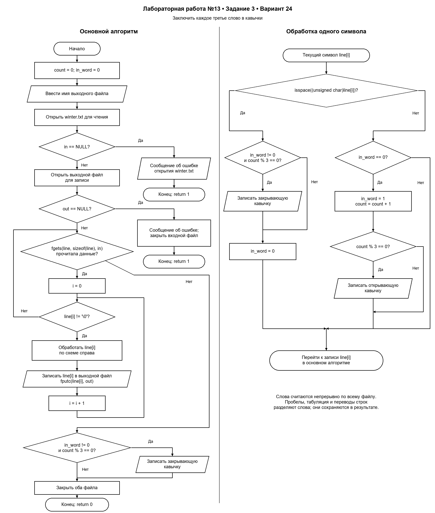

# Лабораторная работа №13

## Задание 3. Вариант 24

Считать текст из файла `winter.txt`, заключить каждое третье слово в двойные кавычки и записать результат в новый файл, имя которого вводит пользователь. Для чтения используется `fgets()`.

## Алгоритм

1. Ввести имя выходного файла.
2. Открыть `winter.txt` для чтения и выходной файл для записи. При ошибке открытия вывести сообщение и завершить программу.
3. Читать текст через `fgets()` и последовательно обрабатывать символы.
4. При начале нового слова увеличивать счётчик `count`. Если номер слова делится на 3, записать перед ним открывающую кавычку.
5. При окончании каждого третьего слова записать закрывающую кавычку.
6. Сохранять исходные символы, включая пробелы и переводы строк.
7. Если файл завершился внутри третьего слова, дописать закрывающую кавычку. Закрыть оба файла.

Счёт слов непрерывен по всему файлу. Слово — последовательность символов между разделителями, определяемыми `isspace()`. Знаки препинания, примыкающие к слову, попадают внутрь кавычек.

## Основные переменные

| Переменная | Назначение |
| --- | --- |
| `in`, `out` | Входной и выходной файловые потоки |
| `filename` | Имя выходного файла |
| `line[1024]` | Буфер для чтения текста |
| `i` | Индекс символа в буфере |
| `count` | Количество начавшихся слов |
| `in_word` | Признак обработки слова: `1` — внутри слова, `0` — вне слова |

## Пример преобразования

Исходный текст:

```text
One two three four five six
```

Результат:

```text
One two "three" four five "six"
```

## Блок-схема



Слева показан основной алгоритм, справа — подробная обработка одного символа из левого блока. Обработка символа в исходной программе выполняется внутри цикла.

## Файлы заданий

| Файл | Содержание |
| --- | --- |
| [zadanie 1 lab 13 .c](zadanie%201%20lab%2013%20.c) | Среднее арифметическое целых чисел из файла |
| [zadanie 2 lab 13.c](zadanie%202%20lab%2013.c) | Замена каждого второго числа на ноль с записью в отдельный файл |
| [zadanie 3 lab 13.c](zadanie%203%20lab%2013.c) | Заключение каждого третьего слова в кавычки |
